# Layered Image Reconstruction

**Single-image scene decomposition into depth-ordered, recomposable RGBA layers.**

    

## Overview

A modular computer vision pipeline that transforms a single RGB image into a structured stack of semantic layers. It combines panoptic segmentation, monocular relative depth estimation, generative completion of occluded regions, soft alpha matting and background reconstruction. Each exported layer can be inspected independently and recomposed into a complete image.

The project explores how a flat photograph can become a more interpretable representation for potential image editing, compositing and scene manipulation applications. It is an individual implementation integrating existing pretrained models, rather than training new foundation models.

## Visual results

The following images are original saved project outputs. No pipeline execution is needed to view them.

| Input image — park | Panoptic segmentation | Relative depth |
|:---:|:---:|:---:|
|  | 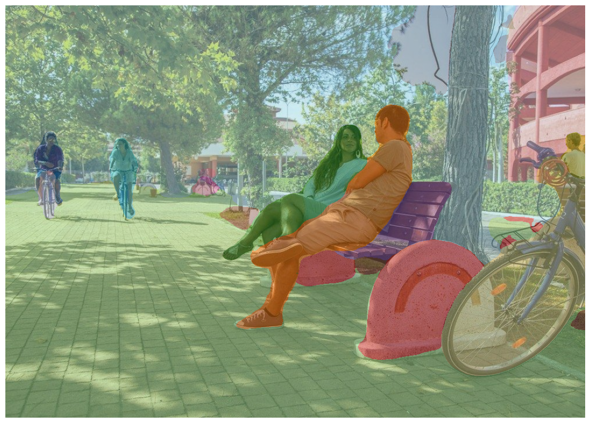 | 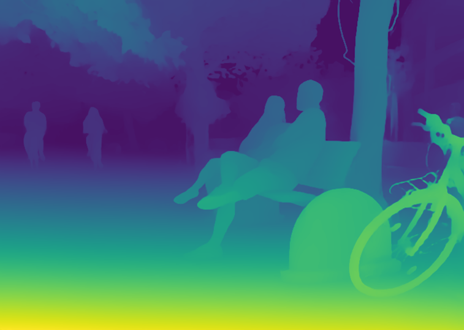 |

| Completed background | Selected object RGBA layer | Recomposed image |
|:---:|:---:|:---:|
| 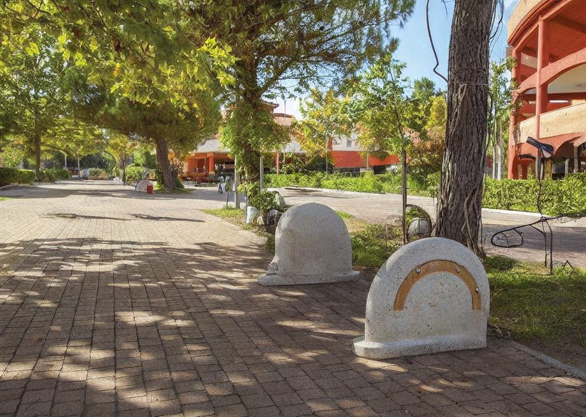 | 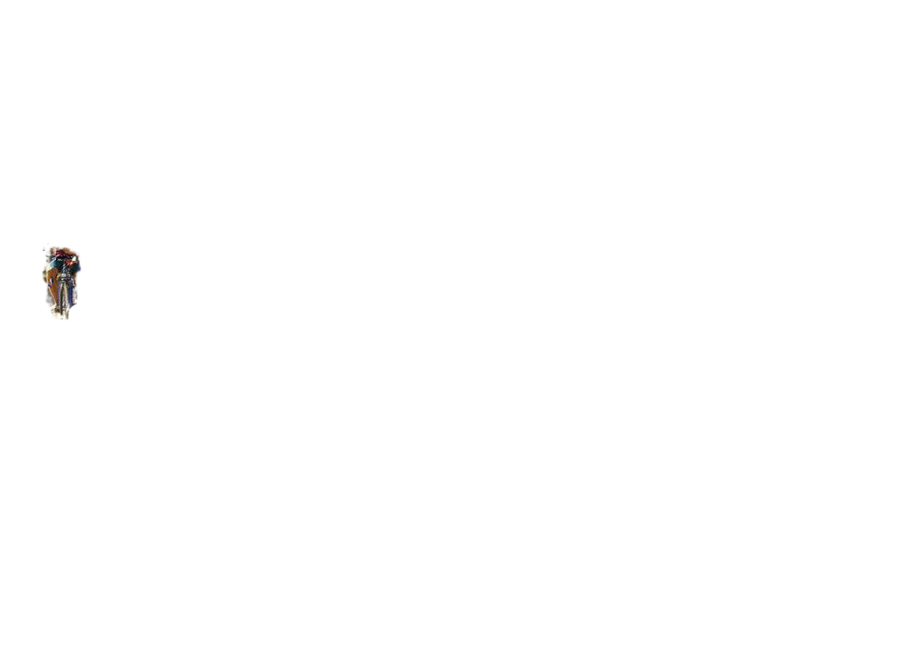 | 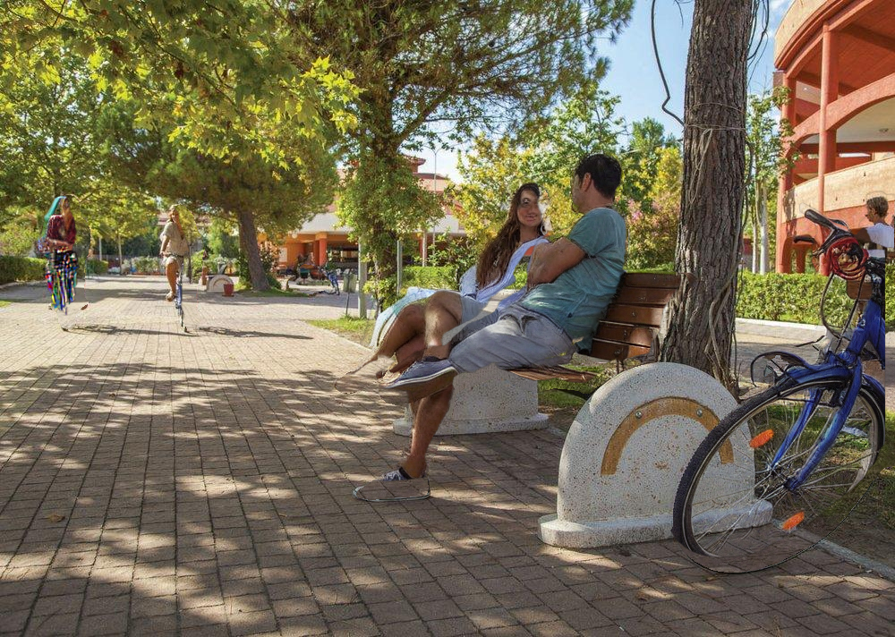 |

### Object completion and appearance decomposition

| Object crop | Generated completion | Final validated mask |
|:---:|:---:|:---:|
| 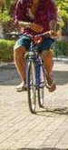 | 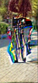 |  |

| Soft alpha | Approximate albedo | Approximate shading |
|:---:|:---:|:---:|
| 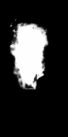 | 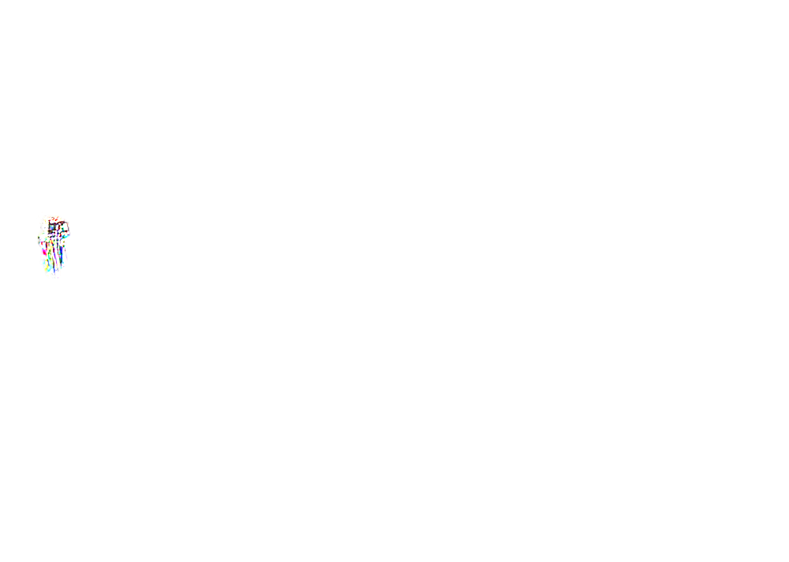 | 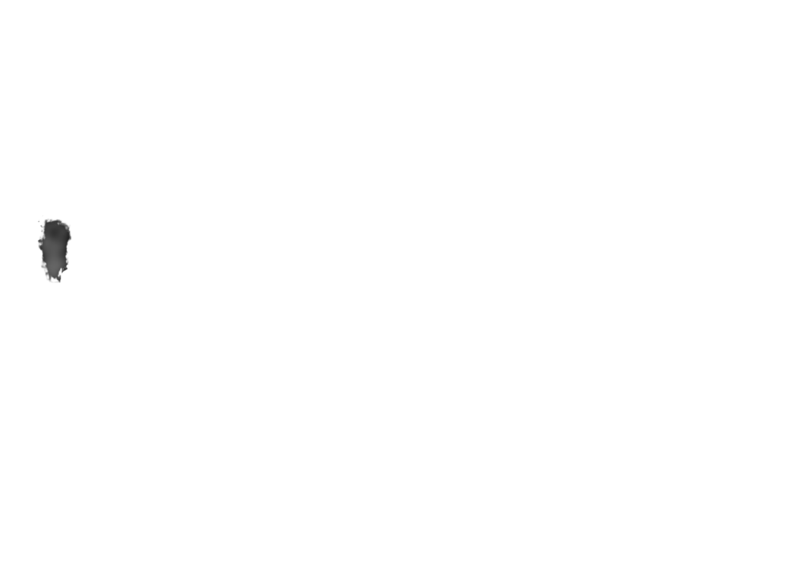 |

## System architecture

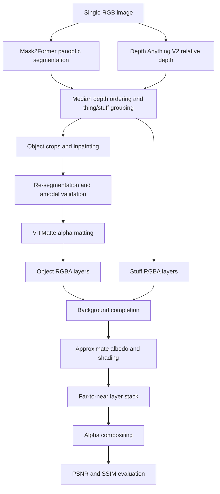

## Technical methodology

| Stage | Implementation |
|---|---|
| Segmentation | Mask2Former identifies object instances and semantic stuff regions. |
| Depth estimation | Depth Anything V2 estimates relative depth from one image. |
| Depth ordering | Median depth within each semantic mask determines layer order; larger depth values are treated as nearer. |
| Amodal completion | Stable Diffusion inpainting proposes missing object appearance from contextual crops. |
| Validation | Mask2Former re-segments the completed crop; same-class predictions are matched against the original visible mask. |
| Alpha matting | ViTMatte estimates soft alpha channels for objects. |
| RGBA construction | Original visible RGB pixels are preserved; generated RGB is used for newly completed hidden regions. Stuff layers use original RGB and segmentation masks. |
| Background | Combined visible object masks guide inpainting of the background. |
| Intrinsic decomposition | Gaussian-smoothed luminance approximates shading; RGB divided by shading approximates albedo. |
| Recomposition | Background-first, far-to-near alpha compositing reconstructs the image. |

### Amodal validation

The original implementation accepts a proposed completion when visible-mask overlap is at least 0.50, mask growth ratio is at most 0.50, and the generated image is not detected as almost entirely black. Otherwise, it falls back to the visible mask. This heuristic limits some completion failures but does not establish hidden-region accuracy.

### Layer representation

`depth_rank = 0` denotes the nearest semantic region. Exported layers use the opposite ordering: `layer_00_background.png` is the base, followed by semantic layers from far to near. `layers_metadata.json` records the layer index, class and available depth information.

The approximate intrinsic representation follows `RGB ≈ Albedo × Shading`. It is a lightweight Retinex-style approximation, not a physically exact or learned intrinsic decomposition.

## Pretrained models

| Model | Checkpoint | Role |
|---|---|---|
| Mask2Former | [facebook/mask2former-swin-small-coco-panoptic](https://huggingface.co/facebook/mask2former-swin-small-coco-panoptic) | Segmentation and re-segmentation |
| Depth Anything V2 | [depth-anything/Depth-Anything-V2-Small-hf](https://huggingface.co/depth-anything/Depth-Anything-V2-Small-hf) | Relative depth |
| Stable Diffusion Inpainting | [stable-diffusion-v1-5/stable-diffusion-inpainting](https://huggingface.co/stable-diffusion-v1-5/stable-diffusion-inpainting) | Object and background completion |
| ViTMatte | [hustvl/vitmatte-small-composition-1k](https://huggingface.co/hustvl/vitmatte-small-composition-1k) | Soft alpha matting |

## Evaluation

The original project includes five test scenes. The table reports the saved **visible-region** metrics, rounded to the precision used in the original documentation.

| Scene | Input | Visible-region PSNR | Visible-region SSIM | Saved results |
|---|:---:|---:|---:|---|
| Park |  | 26.03 dB | 0.9596 | [Metrics](cases/park/evaluation/visible_region_metrics.json) · [Layers](cases/park/final_layers/) |
| Outdoor Tent | 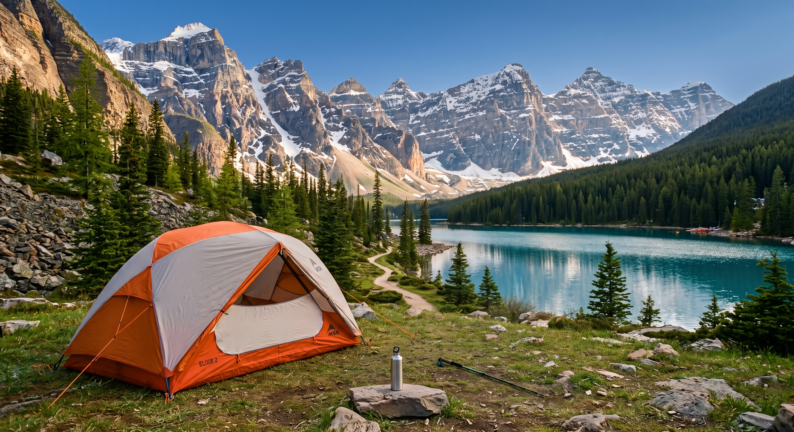 | ∞ | 1.0000 | [Metrics](cases/outdoortent/evaluation/visible_region_metrics.json) · [Layers](cases/outdoortent/final_layers/) |
| Street | 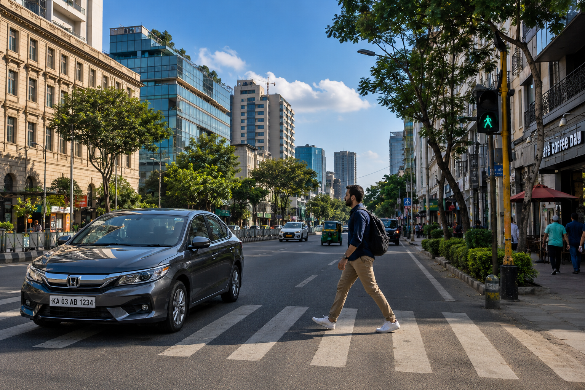 | 32.09 dB | 0.9867 | [Metrics](cases/street/evaluation/visible_region_metrics.json) · [Layers](cases/street/final_layers/) |
| Indoor | 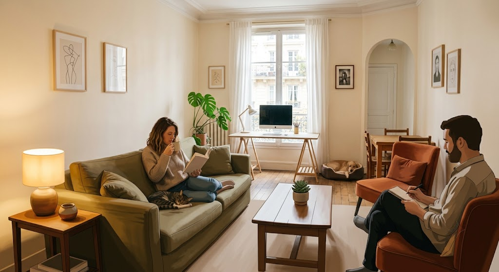 | 24.13 dB | 0.9456 | [Metrics](cases/indoor/evaluation/visible_region_metrics.json) · [Layers](cases/indoor/final_layers/) |
| Dog | 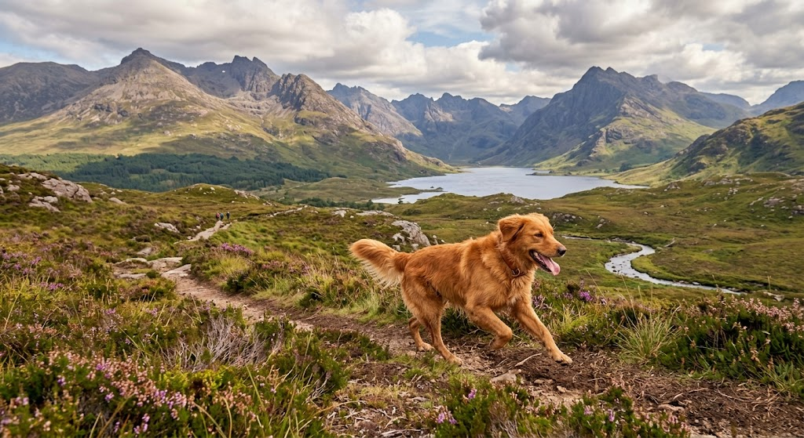 | 27.76 dB | 0.9925 | [Metrics](cases/dog/evaluation/visible_region_metrics.json) · [Layers](cases/dog/final_layers/) |

PSNR measures pixel-level reconstruction error on a logarithmic scale; SSIM measures structural similarity. These saved metrics have not been independently reproduced. They measure visible-image consistency, not the correctness of hallucinated hidden content.

The outdoor-tent case is a special case: the tent is classified as a stuff region, and no object instances are removed. The original image remains the background while the tent is also exported as a semantic layer. The perfect score therefore does not demonstrate perfect amodal reconstruction.

## Repository structure

```text
layered-image-reconstruction/
├── README.md
├── requirements.txt
├── run_pipeline.py
├── stages/
│   ├── segmentation.py
│   ├── depth_estimation.py
│   ├── depth_ordering.py
│   ├── amodal_completion.py
│   ├── alpha_matting.py
│   ├── rgba_layers.py
│   ├── background_completion.py
│   ├── intrinsic_decomposition.py
│   └── final_layers.py
└── cases/
    ├── park/
    ├── outdoortent/
    ├── street/
    ├── indoor/
    └── dog/
```

Each case contains the original input, segmentation masks, depth map, ordering metadata, amodal completion outputs, RGBA layers, intrinsic components, final layer stack and evaluation artifacts. Browse the [park case](cases/park/) for a complete example.

## Getting started

A CUDA-capable GPU is strongly recommended. The pipeline selects CUDA when available and CPU otherwise; CPU execution may be slow. Internet access may be required to retrieve pretrained checkpoints on the first run. The original dependency list is unpinned, so compatibility can vary with installed package versions.

```bash
git clone https://github.com/manushri250/layered-image-reconstruction.git
cd layered-image-reconstruction
python -m venv .venv
```

Activate the environment on Windows PowerShell:

```powershell
.\.venv\Scripts\Activate.ps1
```

On Linux or macOS:

```bash
source .venv/bin/activate
```

Install dependencies and run:

```bash
python -m pip install -r requirements.txt
python run_pipeline.py
```

The entry point loads the four models and processes the five predefined case folders. It selects the first supported image in each input directory. Running it writes intermediate and final artifacts and can overwrite existing results, including the exported layer stack. Keep a backup of the original saved outputs before rerunning.

The supplied entry point generates `evaluation/recomposed.png` and `evaluation/recomposition_metrics.json` using full-image PSNR and SSIM. The separately archived corrected recompositions and visible-region metrics are included as original results; their regeneration is not implemented by the supplied entry point.

## Limitations and future directions

- Relative depth is not calibrated metric depth; a single median depth per region cannot represent complex interleaving geometry.
- Segmentation quality and the pretrained thing/stuff taxonomy constrain downstream reconstruction.
- Inpainting produces plausible rather than verified hidden pixels; mask validation is heuristic.
- Background removal currently targets object instances, not all semantic regions.
- Approximate albedo and shading are not physically recovered scene properties.
- Five example scenes provide a demonstration, not a comprehensive benchmark or evidence of generalization.
- Potential future work includes stronger occlusion reasoning, configurable background removal, more robust validation and reproducible evaluation scripts.

## Contribution and attribution

Individual project by Manushri. The contribution is the integration and orchestration of pretrained models, depth-aware layer construction, completion validation, recomposition and evaluation workflow. Credit for the underlying pretrained models belongs to their respective authors. Model and image usage remains subject to the applicable licenses and permissions.

Original project: [layered_representation_manushri_ob_project](https://github.com/manushri-ed25b029/layered_representation_manushri_ob_project).
